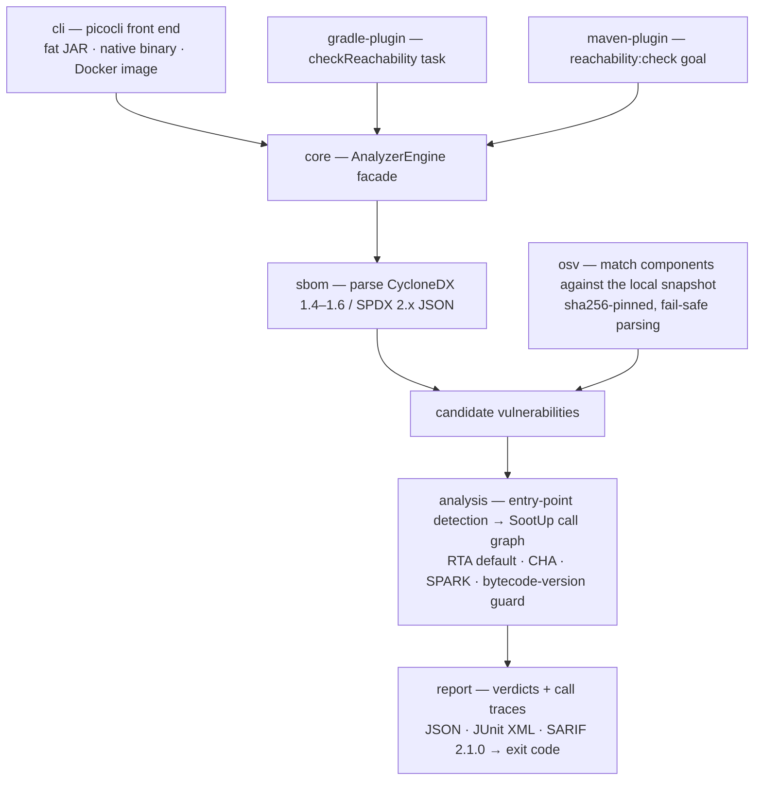

# Callis Java


[](https://github.com/crazyrokr/callis-java/actions/workflows/build-analyzer.yml)

**Is this vulnerability in your SBOM actually reachable from your
application code?**

Callis answers that question in CI. It matches a project's SBOM against a
local OSV snapshot to find candidate vulnerabilities, builds a call graph
from your application's entry points into the dependency bytecode (via
SootUp), and reports **REACHABLE** or **UNREACHABLE** per candidate —
with the call trace that proves it. Any reachable vulnerability exits the
run with code `1` and fails the pipeline; a clean run exits `0`.
Findings ship as JSON, JUnit XML and SARIF.

Status: v1 complete (milestones M0–M6); stretch goals M7a–M7e, the
cacheable `checkReachability` task (M8) and the forked analysis worker
(M9) are done — [details in the reference](docs/reference.md#project-status).

## Getting started

### Prerequisites

| Requirement | Why |
|---|---|
| JDK 25 (Temurin) | the Fat-JAR is Java 25 bytecode; the build toolchain is 25 |
| Maven 3.x | builds the bundled demo and is needed by the Maven front end |
| `curl` | downloads the OSV snapshot |

### Run it on the bundled demo

The demo (`examples/vulnerable-demo`) pins log4j **2.14.1** (log4shell)
on purpose — it is a Maven project, proving the tool analyzes what it
does not build.

```bash
# 1. Build the Fat-JAR
./gradlew shadowJar

# 2. Download the OSV snapshot (writes osv-maven/ + the osv-maven.sha256 pin)
bash scripts/download-osv.sh osv-maven

# 3. Build the demo: CycloneDX SBOM at package time + the resolved classpath
cd examples/vulnerable-demo
mvn -B package
mvn -B dependency:build-classpath -Dmdep.outputFile=target/cp.txt
cd ../..

# 4. Analyze
#    -XX:+UseCompactObjectHeaders (JEP 519, JDK 25) trims the heap on
#    object-heavy targets; the Fat-JAR needs JDK 25 anyway.
java -XX:+UseCompactObjectHeaders -jar cli/build/libs/callis-java-0.1.0-SNAPSHOT-all.jar \
  --app-classes=examples/vulnerable-demo/target/classes \
  --classpath-file=examples/vulnerable-demo/target/cp.txt \
  --sbom=examples/vulnerable-demo/target/bom.json \
  --osv-dir=osv-maven \
  --osv-checksum="$(cut -d' ' -f1 osv-maven.sha256)" \
  --format=json,junitxml,sarif \
  --output=reachability-report
```

**What you should see:** exit code `1`, 8 REACHABLE verdicts, and full
call traces (5–19 hops through real log4j internals) in
`reachability-report.junit.xml`. Switch the demo's `log4j.version`
property to the fixed release **2.25.5**, rebuild, and the same command
exits `0` with zero candidates.

### Run it on your project

1. Emit an SBOM at build time — CycloneDX (`bom.json`) or SPDX 2.x JSON.
2. Write your resolved dependency classpath to a file (colon- or
   newline-separated jars), e.g. `mvn dependency:build-classpath`.
3. Run the CLI as above with your `--app-classes`, `--classpath-file`,
   `--sbom` and `--osv-dir`, or wire it in with the
   [Gradle](#gradle-plugin) / [Maven](#maven-plugin) plugin or the
   [Docker image](#docker).

## Architecture

### How the pieces fit



Every front end calls the same `AnalyzerEngine` in `core`, so the CLI,
the plugins and the container verdict-match by construction.

### Modules

| Module | Role |
|---|---|
| `core` | The whole pipeline: `sbom` (parsers, purl → coordinates), `osv` (records, version-range matching, snapshot checksum), `analysis` (bytecode guard, entry points, call graph, reachability + traces), `report` (the three writers), plus the `AnalyzerEngine` facade |
| `cli` | picocli front end; Shadow fat JAR; GraalVM native-image binary; basis of the Docker image |
| `gradle-plugin` | Plugin id `org.crazyrock.callis`, `checkReachability` task (cacheable, forked worker JVM) |
| `maven-plugin` | `org.crazyrock.callis:callis-maven-plugin`, goal `reachability:check` — a separate Maven build inside this repo (recorded deviation, [ADR 0011](docs/adr/0011-build-modules-gradle-maven-plugins.md)) |
| `tools/coveragetool` | Per-package coverage gates evaluated against core's JaCoCo data ([ADR 0018](docs/adr/0018-coverage-gate-tooling.md)) |

### Execution model

- **JVM Fat-JAR** — `java -jar` on JDK 25; the reference invocation adds
  `-XX:+UseCompactObjectHeaders`.
- **Native binary** — `./gradlew :cli:nativeCompile` (GraalVM 25)
  produces a ~21 MB statically-linked binary with millisecond startup
  and verdict-identical reports.
- **Docker** — the native binary in a ~24 MB `distroless/base` image:
  `ghcr.io/crazyrokr/callis-java`.
- **Gradle plugin** — the task is `@CacheableTask` (content-sensitive
  inputs) and runs the analysis in a **forked worker process** so a huge
  call graph cannot starve the daemon.
- **Maven plugin** — runs in-process during `verify`.

### Verdict semantics (summary)

- OSV Maven data is package-level, so verdicts are **artifact-level** by
  default; `--mappings` pins exact classes/methods per CVE.
- **RTA** is the default call-graph policy; `--cha` and
  `--pointer-analysis` (SPARK) are the over- and under-approximating
  alternatives.
- Reflection defeats static analysis: an artifact on the classpath with
  no static path is UNREACHABLE **with an `onClasspath: true` notice**,
  making the dangerous false-negative direction visible.
- Full trade-offs in
  [Precision limitations](docs/reference.md#precision-limitations-adr-0005).

## Configuration

### CLI options (the essentials)

| Option | Meaning |
|---|---|
| `--app-classes=<dir>` | Compiled application classes to analyze |
| `--classpath-file=<file>` | Resolved dependency classpath (colon- or newline-separated jar list) |
| `--sbom=<file>` | CycloneDX or SPDX 2.x JSON SBOM (auto-detected) |
| `--osv-dir=<dir>` | Local OSV snapshot directory |
| `--osv-checksum=<sha256>` | Expected sha256 of the snapshot; a mismatch fails with exit 2 |
| `--mappings=<file>` | Optional `vuln-mappings.json` for class/method-level precision |
| `--format=json,junitxml,sarif` | Report formats to write (default `json,junitxml`) |
| `--output=<base>` | Report base name (default `reachability-report`; files are `<base>.json`, `<base>.junit.xml`, `<base>.sarif`) |
| `--entry-points` / `--callback-interfaces` | Override / extend entry-point detection |
| `--cha` / `--pointer-analysis` | Call-graph policy instead of RTA |
| `-v, --verbose` | Diagnostics: entry points, graph size, durations, written files |

Exit codes: **0** no reachable vulnerability (incl. zero candidates) ·
**1** at least one REACHABLE · **2** usage/config error · **3** analysis
failure.

The [full CLI reference](docs/reference.md#cli-reference) covers every
option, the hidden debug (`--dry-run-*`) modes and the stale-report
guarantee.

### OSV snapshot

`bash scripts/download-osv.sh [dest]` fetches the OSV Maven snapshot and
writes `osv-maven.sha256` next to it — the same value the analyzer
computes, so `--osv-checksum="$(cut -d' ' -f1 osv-maven.sha256)"`
refuses a changed or tampered snapshot. For air-gapped setups, publish
the zip to your internal repo and unzip it in place of the download;
`--osv-dir` is the only contract.

### Gradle plugin

```kotlin
plugins {
    id("java")
    id("org.crazyrock.callis")
}

reachability {
    bomFile = "build/bom.json"   // CycloneDX or SPDX 2.x SBOM of the project
    osvDir = "osv-maven"         // local OSV snapshot directory
    // optional: mappings, expectedOsvChecksum, entryPoints,
    // callbackInterfaces, cha, pointerAnalysis, formats, maxHeapSize ("1g")
}
```

`checkReachability` analyzes the main source set and fails the build when
any SBOM vulnerability is reachable; reports go to
`build/reachability-report.{json,junit.xml[,sarif]}`.

### Maven plugin

```bash
# after your CycloneDX plugin wrote target/bom.json at package time
mvn org.crazyrock.callis:callis-maven-plugin:0.1.0-SNAPSHOT:check \
    -Dreachability.sbomFile=target/bom.json -Dreachability.osvDir=../osv-maven
```

Goal `reachability:check` runs by default in `verify`, fails the build on
any reachable vulnerability, and writes
`target/reachability-report.{json,junit.xml[,sarif]}`.

### Docker

```bash
docker pull ghcr.io/crazyrokr/callis-java:latest

docker run --rm \
  -v "$(pwd)/examples/vulnerable-demo:/work" \
  -v "$(pwd)/osv-maven:/osv:ro" \
  -v "$HOME/.m2:$HOME/.m2:ro" \
  ghcr.io/crazyrokr/callis-java \
  --app-classes=/work/target/classes \
  --classpath-file=/work/target/cp.txt \
  --sbom=/work/target/bom.json \
  --osv-dir=/osv \
  --osv-checksum="$(cut -d' ' -f1 osv-maven.sha256)" \
  --output=/work/reachability-report
```

The image has no shell — only the CLI's own flags work. Mount everything
the classpath file references at the same absolute path, or unreadable
jars silently degrade a component's verdict to `NO_CLASS_INFO`.
Details: [Docker image reference](docs/reference.md#docker-image-adr-0022).

### vuln-mappings.json (optional)

Pin the vulnerable classes/methods for critical CVEs to refine
artifact-level verdicts — the key is the OSV/GHSA id, entries are
`class` + optional `method`/`descriptor`:

```json
{
  "CVE-2021-44228": [
    {"class": "org.apache.logging.log4j.core.lookup.JndiLookup", "method": "lookup"}
  ]
}
```

Validation and fallback rules:
[vuln-mappings reference](docs/reference.md#vuln-mappingsjson-classmethod-level-precision).

## CI/CD templates

- **GitHub Actions**: `.github/workflows/reachability-check.yml` —
  consumer template (JDK 25 → OSV download → build → analyze → always
  upload reports).
- **Jenkins**: `Jenkinsfile` — declarative pipeline with an OSV cache
  (`stash`) and archived reports on every outcome.

## Documentation

| Document | Contents |
|---|---|
| [docs/reference.md](docs/reference.md) | Full option table, exit-code contract, SBOM/SARIF/mapping rules, native & Docker build details, plugin behavior, precision limits, OSV operations, toolchain pins |
| [docs/adr/0001-architecture.md](docs/adr/0001-architecture.md) | ADR index — one ADR per decision, 0002–0022 |
| [implementation-plan.md](implementation-plan.md) | Milestone plan and verification records |

## Contributing

1. Every architectural change amends the relevant decision in
   `docs/adr/` (one ADR per decision; 0001 is the index).
2. Tests are Spock/Groovy (Given-When-Then); new code ships with full
   unit coverage including false-positive scenarios.
3. All version pins go through `gradle/libs.versions.toml` — the single
   source of truth.
4. Before pushing, run `./gradlew check` (tests + Checkstyle + SpotBugs +
   `coverageGate`); CI (`build-analyzer` on `main`) runs the same.

## License

No `LICENSE` file has been committed yet (TODO). The project is a
greenfield implementation documented through its
[ADRs](docs/adr/0001-architecture.md).
